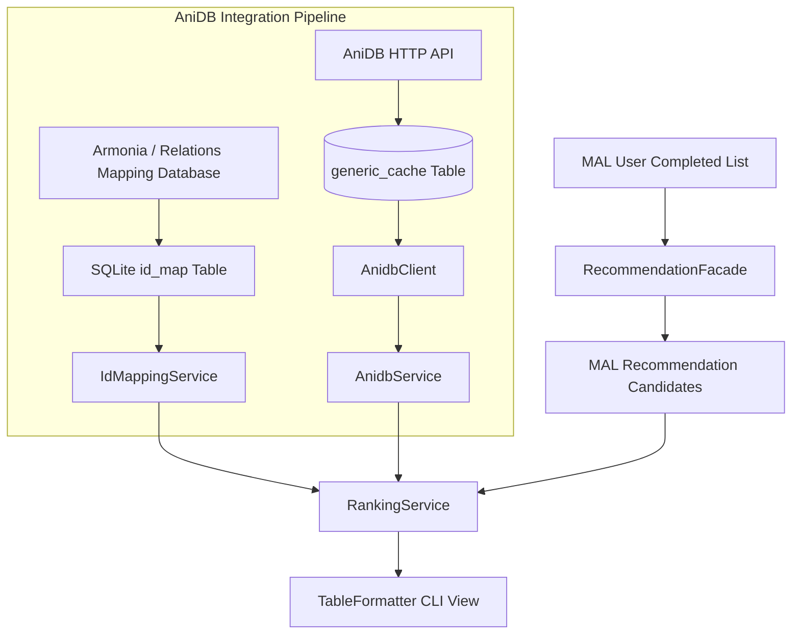

# Design Document: AniDB API Integration

This document outlines the proposed architecture, implementation steps, and data contracts required to integrate the **AniDB HTTP API** (specifically the **Hot Anime** feed) into the Anime Recommendation CLI application.

---

## 1. Objectives

1.  **Introduce a Real-Time Trending Signal:** Supplement MAL's static, cumulative member count popularity with AniDB's active engagement and file/discussion activity metrics.
2.  **Mitigate Vote Manipulation:** Blend MAL community ratings with AniDB's damped, Bayesian-weighted ratings.
3.  **Harden Franchise Grouping:** Supplement relation edges (sequel, prequel, side story, summary) by cross-referencing with AniDB's relation graph.

---

## 2. Proposed Integration Architecture

AniDB and MAL operate on separate ID systems. Because of this, the pipeline requires an intermediate **ID Translation Layer** to cross-reference data.



---

## 3. Translation Strategy: MAL ID to AniDB ID

To map IDs without calling external mapping APIs on every request, we will download and persist a community mapping index:

1.  **Primary Option:** Integrate the community-maintained [anime-relations](https://github.com/erengy/anime-relations) index or the [Armonia/Anime-Lists](https://github.com/Anime-Lists/anime-lists) XML/JSON map.
2.  **Database Migration (Flyway):** Add an `id_mapping` table:
    ```sql
    CREATE TABLE id_mapping (
        mal_id INTEGER PRIMARY KEY,
        anidb_id INTEGER NOT NULL
    );
    CREATE INDEX idx_id_mapping_anidb ON id_mapping(anidb_id);
    ```
3.  **One-Time Setup/Schedule:** Introduce a scheduled task (`BackgroundMappingFetchService`) that pulls the JSON/XML mapping file once a week, parses it, and populates the SQLite `id_mapping` table.

---

## 4. AniDB HTTP API Data Contracts

### 4.1. Request Signature
The HTTP request to pull the trending list (Hot Anime) must contain client identification to comply with AniDB's terms of service:
```http
GET http://api.anidb.net:9001/httpapi?client=anime_recommendation_cli&clientver=1&protover=1&request=hotanime
```

### 4.2. Response XML Structure
The API returns XML data. Below is the parsed target schema:
```xml
<hotanime>
  <anime id="18243" rating="8.10" rank="1">
    <title>Chainsaw Man Season 2</title>
  </anime>
  <anime id="17942" rating="7.85" rank="2">
    <title>Frieren: Beyond Journey's End (Sequel)</title>
  </anime>
</hotanime>
```

### 4.3. Java DTO Model
We will use Jackson's XML parser to serialize the response into Java classes:
```java
package com.gordonpn.anime.models.dto.anidb;

import com.fasterxml.jackson.dataformat.xml.annotation.JacksonXmlElementWrapper;
import com.fasterxml.jackson.dataformat.xml.annotation.JacksonXmlProperty;
import com.fasterxml.jackson.dataformat.xml.annotation.JacksonXmlRootElement;
import lombok.Data;
import java.util.List;

@Data
@JacksonXmlRootElement(localName = "hotanime")
public class AnidbHotAnimeResponse {

    @JacksonXmlProperty(localName = "anime")
    @JacksonXmlElementWrapper(useWrapping = false)
    private List<AnidbHotAnimeEntry> items;
}

@Data
public class AnidbHotAnimeEntry {

    @JacksonXmlProperty(isAttribute = true)
    private Integer id;

    @JacksonXmlProperty(isAttribute = true)
    private Double rating;

    @JacksonXmlProperty(isAttribute = true)
    private Integer rank;

    @JacksonXmlProperty(localName = "title")
    private String title;
}
```

---

## 5. Technical Implementation Tasks

### Phase 1: Build/DTO Configuration
*   Add the Jackson XML dataformat dependency to `build.gradle`:
    ```groovy
    implementation 'com.fasterxml.jackson.dataformat:jackson-dataformat-xml'
    ```
*   Create DTOs for the XML models.

### Phase 2: Create HTTP Client and caching
*   Implement `AnidbClient` using `RestClient`.
*   Implement `AnidbService` with database caching:
    - Save raw XML responses to the `generic_cache` SQLite table.
    - Set cache TTL to **1 day** (as trending/hot statistics shift slowly).
    - Configure fail-safe recovery: If AniDB times out or rate-limits, return the expired database cache instead of throwing an error.

### Phase 3: Implement ID Mapping Service
*   Create a Flyway migration file to define the `id_mapping` table.
*   Implement `IdMappingService` to parse community relations maps and perform fast SQLite mapping queries (`findAnidbIdByMalId`).

### Phase 4: Enhance Recommendation Engine
*   In `RankingService.java`, add a trending weight:
    ```java
    public double calculateScore(double occurrence, Double rating, Integer popularity, boolean isTrending) {
        double baseScore = calculateScore(occurrence, rating, popularity);
        if (isTrending) {
            // Apply a 25% boost to final score for trending titles
            return baseScore * 1.25;
        }
        return baseScore;
    }
    ```
*   In `RecommendationFacade.java`, update step 4 to query the `IdMappingService` for the candidate's AniDB ID, check the cached `hotanime` list, and apply the trending boost in `RankingService`.

---

## 6. Safety & Rate Limiting Compliance Policies

AniDB enforces strict, permanent IP-ban rules. The integration must implement the following safeguards:

> [!CAUTION]
> **Strict Anti-Ban and Caching Policies**
> 1. **Sequential Intercepting:** All AniDB API connections must be configured with a sequential interceptor limiting throughput to a maximum of **one query per 3 seconds**. No parallel threads should query AniDB.
> 2. **Cache-First Strategy:** The CLI must never call the AniDB API directly on a recommendation recalculation. The application must load and verify the cached SQLite `hotanime` entries first.
> 3. **User-Agent String:** The HTTP header must include a descriptive, custom `User-Agent` string (e.g. `User-Agent: AnimeRecommendationCLI/1.0 (gordonpn)`). Generic Java HTTP headers trigger automatic blocks.
