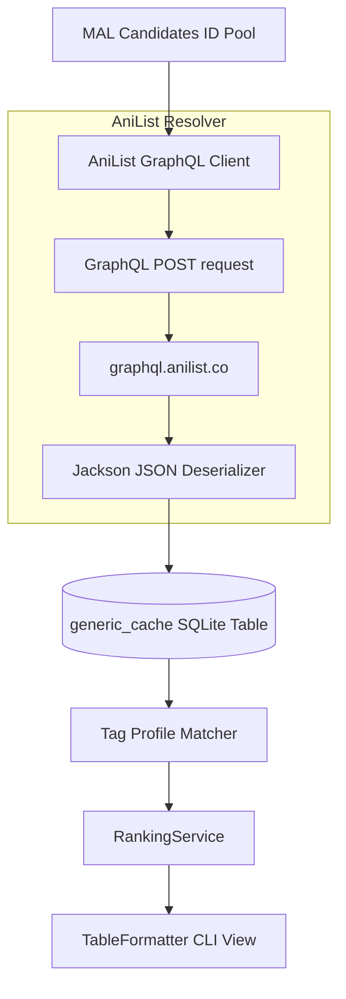

# Design Document: AniList API Integration for Discovery

This document outlines the proposed design, API schema, and query structures to integrate the **AniList GraphQL API** into the Anime Recommendation CLI. Integrating AniList focuses directly on enhancing the **discovery engine** using AniList's tag systems and GraphQL querying efficiency.

---

## 1. Objectives for Enhanced Discovery

1.  **Tag-Based Taste Modeling:** Move beyond MAL's generic genres (e.g., "Action", "Drama") by utilizing AniList's fine-grained **user-voted tags** (e.g., "Time Loop", "Cyberpunk", "Anti-Hero") with numeric relevance percentages.
2.  **No ID Mapping Overhead:** AniList includes native MyAnimeList IDs (`idMal`) directly in its `Media` database schema, enabling zero-overhead cross-referencing.
3.  **Preventing API Over-fetching:** Leverage GraphQL to request only the fields necessary for ranking (such as studios, averages, popularity, and relation nodes).

---

## 2. API Architecture & Flow

Because AniList includes `idMal` natively, we can query candidate metadata from AniList using their MAL IDs directly:



---

## 3. GraphQL Query Design

AniList uses a single POST endpoint: `https://graphql.anilist.co`. No API keys or OAuth authentication are required for reading metadata.

### 3.1. Querying Multiple Candidates (Bulk Fetching)
To minimize network roundtrips, we fetch multiple candidates using the `idIn` query parameter:

```graphql
query ($ids: [Int]) {
  Page {
    media (idMal_in: $ids, type: ANIME) {
      idMal
      id
      title {
        romaji
        english
      }
      averageScore
      popularity
      genres
      studios(isMain: true) {
        nodes {
          name
        }
      }
      tags {
        name
        rank
        category
      }
      startDate {
        year
      }
    }
  }
}
```

---

## 4. Java Data Contracts & DTOs

### 4.1. Request DTO
We will define a generic GraphQL request DTO:
```java
package com.gordonpn.anime.models.dto.anilist;

import lombok.Builder;
import lombok.Data;
import java.util.Map;

@Data
@Builder
public class AnilistGraphQLRequest {
    private String query;
    private Map<String, Object> variables;
}
```

### 4.2. Response DTO
We will deserialize AniList's nested JSON structure using standard Jackson models:
```java
package com.gordonpn.anime.models.dto.anilist;

import com.fasterxml.jackson.annotation.JsonProperty;
import lombok.Data;
import java.util.List;

@Data
public class AnilistResponse {
    private AnilistData data;
}

@Data
public class AnilistData {
    @JsonProperty("Page")
    private AnilistPage page;
}

@Data
public class AnilistPage {
    private List<AnilistMedia> media;
}

@Data
public class AnilistMedia {
    private Integer id;
    private Integer idMal;
    private AnilistTitle title;
    private Double averageScore;
    private Integer popularity;
    private List<String> genres;
    private List<AnilistTag> tags;
    private AnilistStudios studios;
    private AnilistStartDate startDate;
}

@Data
public class AnilistTitle {
    private String romaji;
    private String english;
}

@Data
public class AnilistTag {
    private String name;
    private Integer rank; // Percentage rank (0-100)
    private String category;
}

@Data
public class AnilistStudios {
    private List<AnilistStudioNode> nodes;
}

@Data
public class AnilistStudioNode {
    private String name;
}

@Data
public class AnilistStartDate {
    private Integer year;
}
```

---

## 5. Technical Implementation Steps

### Phase 1: Establish `AnilistClient`
*   Create a dedicated HTTP client bean (`anilistClient`) targeting `https://graphql.anilist.co`.
*   Implement `postQuery(String query, Map<String, Object> variables)` executing a POST request with the JSON payload.

### Phase 2: Create a Tag Taste Profile
*   When loading the user's completed list, fetch the AniList details for all completed shows.
*   Aggregate their tags and ranks to construct a **User Tag taste Profile** (e.g. Map of `TagName -> CumulativeWeight`). For instance, if the user watched multiple highly rated show containing the tag "Time Loop", "Time Loop" will have a high profile score.

### Phase 3: Enhance Recommendation Ranking
*   When calculating the candidate scores, calculate a **Content-Based Tag Similarity Score** between the candidate's tags and the User Tag Taste Profile.
*   Update `RankingService.java` to incorporate tag similarity:
    ```java
    public double calculateScore(double occurrence, Double rating, Integer popularity, double tagSimilarity) {
        double baseScore = calculateScore(occurrence, rating, popularity);
        // Blend tag similarity into the base relevance score
        return baseScore * (1.0 + tagSimilarity);
    }
    ```

---

## 6. Rate Limiting Safeguards

AniList implements a rate limit of **90 requests per minute**. 

> [!IMPORTANT]
> **AniList API Compliance Policies**
> 1. **Response Headers Monitoring:** Inspect rate limit status headers (`x-ratelimit-remaining`, `x-ratelimit-reset`) returned in AniList responses. If remaining requests drop below 10, sleep the thread until the reset epoch is reached.
> 2. **Aggressive Page Querying:** Never query titles one by one. Always execute bulk queries using pages of up to 50 IDs to conserve rate limits.
